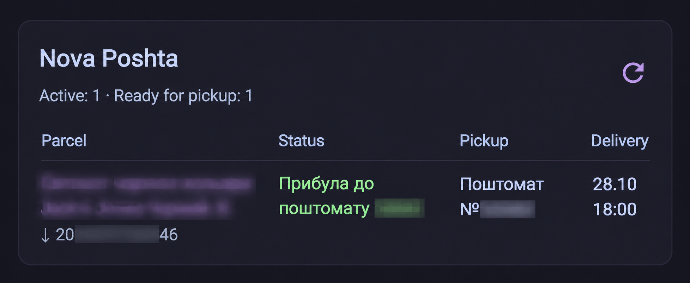

# Nova Poshta · My Parcels

Automatically discover and track incoming and outgoing Nova Poshta parcels in Home Assistant using your account API key. Tracking numbers are added automatically. The integration includes its own dashboard card and visual editor: no Markdown, Jinja templates, or separate card installation required.

## Features

- One card with active and ready-for-pickup counts, a parcel table, and a refresh button.
- Detailed current tracking events, pickup locations, estimated delivery dates and times, and tracking links.
- Visual settings for columns, incoming/outgoing parcels, compact layout, and language.
- Optional **Hide when there are no active parcels** setting. It respects the direction selected in the card. Connection errors stay visible.
- Follows the Home Assistant interface language by default; Russian, Ukrainian, and English can also be selected manually.
- Change your API key at any time in the integration options. A blank field keeps the existing key. Replacement keys are validated before saving.
- Default polling interval: 15 minutes, configurable from 5 to 1440 minutes. Default lookback: 365 days, configurable from 1 to 730 days.

## Requirements

Home Assistant 2026.6 or later, the standard Home Assistant frontend, and a Nova Poshta account API key. The account must have access to the parcels you want to track.

Get your API key from the [Developers settings in your Nova Poshta account](https://new.novaposhta.ua/dashboard/settings/developers). Sign in to your account first.

## Screenshot



The parcel description, part of the tracking number, and the parcel locker number have been blurred for privacy.

## Install with HACS

1. Open **HACS → menu → Custom repositories**.
2. Add `https://github.com/munris-vlad/ha-nova-poshta` with the **Integration** category.
3. Download the integration and restart Home Assistant.
4. Go to **Settings → Devices & services → Add integration** and search for **Nova Poshta · My Parcels** (or the translated name).
5. Get your key from [Nova Poshta → Settings → Developers](https://new.novaposhta.ua/dashboard/settings/developers), then enter it and choose the polling settings.
6. Refresh your browser. Edit your dashboard, choose **Add card**, and select **Nova Poshta · Parcels**.

The card is bundled with the integration and loads automatically. You do not need a separate HACS Dashboard repository or manual resource registration. If you have multiple accounts, select the required sensor in the card editor.

For manual installation, copy `custom_components/nova_poshta_account` into `/config/custom_components/`, restart Home Assistant, and follow steps 4–6.

## Change the API key

Open **Settings → Devices & services → Nova Poshta · My Parcels → Configure → New API key**.

Leave the field blank to keep your current key. Enter a replacement key to update it. The replacement is validated before saving; if validation fails, the existing credentials and settings remain unchanged. Changes apply without restarting Home Assistant. The current key is never prefilled in the form.

You can also change the account directions, polling interval, and lookback period here.

## Card settings

Add the card through the dashboard card picker. It is also suggested when adding the integration's active-parcels sensor. The visual editor supports:

- Account sensor and custom title.
- Incoming, outgoing, or both directions.
- Columns: parcel, status, pickup, and delivery.
- Compact layout and refresh button.
- Hide when no active parcels match the selected direction; disabled by default. The card reappears when a parcel becomes active.
- Automatic Home Assistant language or a manual language override.

Card filters affect presentation. Use the integration options to change which data is loaded from the API. Estimated delivery time is displayed in the Home Assistant time zone and remains the carrier's estimate.

## Entities and privacy

Each account creates an active-parcels sensor with a `parcels` attribute, a ready-for-pickup sensor, and a refresh button. The card uses a single entity: the active-parcels sensor. It automatically finds the related refresh button, including renamed entities.

The API key is stored in the Home Assistant config entry. The card receives prepared data through Home Assistant and never calls Nova Poshta directly. API keys, phone numbers, payment details, and internal customer IDs are excluded from entity attributes. Parcel lists and refresh timestamps are excluded from Recorder history.

## API behavior and limitations

Only read requests are used:

- `InternetDocument.getIncomingDocumentsByPhone` and `getOutgoingDocumentsByPhone` discover account parcels.
- Public `GET /site/v.1.0/shipments/tracking/{ttn}` with Ukrainian localization retrieves detailed tracking events and delivery estimates.

Every page is loaded until an empty page is returned. Repeated pages or more than 100 pages produce an error rather than a silently incomplete list. Shipments older than the selected lookback window are not included.

Terminal status codes 2, 3, 9, 10, 11, 102, 103, and 106, deleted waybills, and parcels with a receiving timestamp are excluded. Unknown statuses remain visible. Detailed statuses use the current `now` event, or the latest completed `passed` event; planned future events are never used as current statuses.

If the account list cannot be retrieved, sensors become unavailable instead of reporting zero parcels. If only detailed tracking fails, the fresh general account status is shown. Detailed requests are limited to four concurrent requests.

The account and public tracking endpoints may change. This is an independent project and is not an official Nova Poshta product.

## Development

Version **0.2.1**, MIT license. The repository includes HACS metadata and GitHub Actions for HACS, hassfest, API tests, and JavaScript validation. These checks must pass before submission to the default HACS catalog. Adding this repository manually does not require catalog inclusion.

API tests (requires aiohttp and tzdata):

```sh
python -m unittest discover -s tests -p test_api.py -v
```

Full tests, including API key replacement, require a Home Assistant runtime:

```sh
python -m unittest discover -s tests -v
```

Card behavior checks:

```sh
node --test tests/card.test.cjs
```
